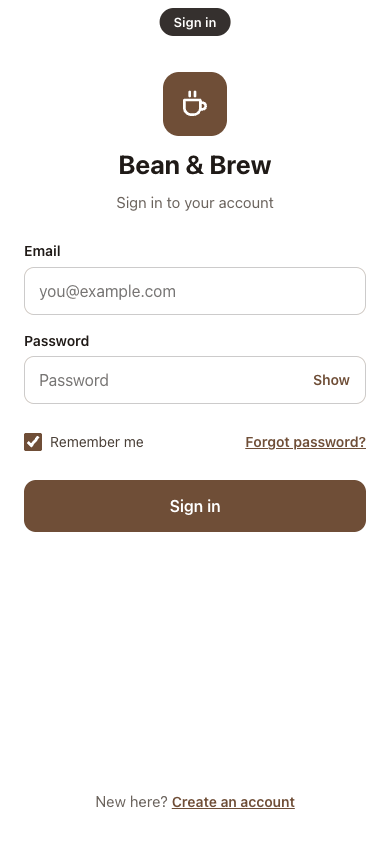

# Bean & Brew: demo app for test automation

A small coffee shop web app (React + Vite) with an in-memory mock backend (Express). It exists to be a realistic, stable target for UI automation (Playwright, Selenium) and API tests.

The user journey: **Login → Home → Product → Cart → Checkout → Order confirmed**, plus Create account, Forgot password, Favorites and Profile (details, address, notification preferences, log out).

<p align="center">
  
</p>

<p align="center"><sub>45-second walkthrough, recorded automatically with Playwright (<code>npm run demo:record</code>).</sub></p>

## Run it

Needs Node 20 or newer.

```bash
npm install
npm run dev
```

- Web app: http://localhost:5173
- Mock API: http://localhost:4000/api (the web app proxies `/api` to it)

Other scripts:

| Script | What it does |
|---|---|
| `npm run dev` | API (auto-restarts on change) + Vite dev server |
| `npm run build` | Production build into `dist/` |
| `npm run preview` | API + the built app on http://localhost:4173 |
| `npm run api` | Just the API |
| `npm run demo:record` | Re-records `docs/demo.gif` (needs `npm run dev` running and Google Chrome installed). Resets the seed data before and after |
| `npm run build:android` | Builds the web app for Android (`--mode android`, see below) and copies it into the Capacitor project with `cap sync android` |
| `npm run apk:debug` | Builds the debug APK into `android/app/build/outputs/apk/debug/app-debug.apk` (needs JDK 17 and the Android SDK) |

Environment variables:

| Variable | Default | Use |
|---|---|---|
| `API_PORT` | `4000` | Port for the mock API (the Vite proxy follows it) |
| `API_LATENCY_MS` | `0` | Adds a delay to every API response, for practising waits |
| `VITE_API_BASE` | empty | Build-time API address. Empty means same origin, so the web app uses the Vite proxy. The Android build sets it to `http://10.0.2.2:4000` in [.env.android](.env.android) |

### Android app (Capacitor)

The same web app also runs as a hybrid Android app: [Capacitor](https://capacitorjs.com/) 6 wraps the built `dist/` in an Android WebView (`com.beanbrew.demo`, config in [capacitor.config.json](capacitor.config.json)). It's there so mobile tools such as Maestro can drive the app on an emulator.

- Inside the emulator the app calls the API on your computer at `http://10.0.2.2:4000` (the emulator's alias for the host). Keep `npm run api` (or `npm run dev`) running.
- The API sends CORS headers for the Capacitor origins (`http://localhost`, `https://localhost`, `capacitor://localhost`) and the Vite ports, since the app and API are on different origins there.
- Debug builds allow plain HTTP to `10.0.2.2` only ([android/app/src/debug](android/app/src/debug)). Release builds keep Android's default.

```bash
npm run build:android
npm run apk:debug
adb install -r android/app/build/outputs/apk/debug/app-debug.apk
```

If `java -version` isn't 17, point `JAVA_HOME` at a JDK 17, for example the one bundled with Android Studio: `export JAVA_HOME="/Applications/Android Studio.app/Contents/jbr/Contents/Home"`.

## Test data

All state is in memory and resets when the API restarts. Seed data lives in [server/seed.js](server/seed.js).

**Accounts** (password for all: see `USERS` in `server/seed.js`)

| Email | Purpose |
|---|---|
| `demo@beanbrew.test` | Happy path: has an address and two favorites |
| `noaddress@beanbrew.test` | No shipping address, so checkout is blocked |
| `locked@beanbrew.test` | Login returns 423 "account locked" |

You can also create accounts on the Create account screen (`/signup`). New accounts start with no address and no favorites, are signed in straight away for that tab only, and disappear on reset. Passwords need 8+ characters with a letter and a number. Registering an email that already exists returns 409.

**Cards** (any future expiry such as `12/30`, any 3-digit CVC)

| Number | Result |
|---|---|
| `4242 4242 4242 4242` | Order succeeds |
| `4000 0000 0000 0002` | Card declined (402) |
| Anything failing the Luhn check | Field validation error |

**Promo codes:** `BREW10` (10% off), `WELCOME20` (20% off). Codes are case-insensitive.

**Business rules worth asserting**

- Bean sizes: 250 g is the base price, 500 g ×1.8, 1 kg ×3.4 (rounded to the cent).
- Quantity per cart line is 1–10. The same product with the same grind and size merges into one line.
- Standard shipping is $5.00, or free when the subtotal after discount is $75.00 or more. Express is always $12.00.
- Tax is 8% of the subtotal after discount.
- `Hand Grinder` is out of stock and can't be added to the cart.
- Home lists all 14 products under "All products" (scroll to see them all). Four carry a "Popular" tag. Search and categories narrow the list.

## Test hooks

- **Reset state:** `POST /api/test/reset` restores the seed data and signs everyone out. Call it in `beforeEach` for isolated tests.
- **Selectors:** every screen root, input, button and list row has a `data-testid`. Playwright: `page.getByTestId('login-submit')`. Selenium: `By.cssSelector("[data-testid='login-submit']")`.
- **Element ids:** each test ID is also set as the element's HTML `id` (via `tid()` in [src/testid.js](src/testid.js)), because tools that read the accessibility tree, such as Maestro in an Android WebView, see the `id` but not `data-testid`. Maestro: `id: login-submit`. Exception: test IDs repeated on every Home card (`product-name`, `product-price`, `product-popular`, `product-out-of-stock`) get the product id appended to their `id`, for example `product-name-ceramic-mug`.
- **Auth token:** after login the token is stored as `bb_token` in `localStorage` ("Remember me" on) or `sessionStorage` (off). To skip the login UI, call `POST /api/auth/login`, put the token in storage, then open the page.
- Signed-out visits to a protected page redirect to `/login`, then back to that page after sign-in.
- **Theme:** Profile → Appearance has a Theme dropdown (`appearance-select`: `light`, `dark`, `system`) applied when you press Save changes. The choice is saved on the account (`appearance` on `/api/me`) and in `localStorage` as `bb_theme`. The active theme is on `<html data-theme="light|dark">`, which is easy to assert on.
- **Profile settings:** each settings page has its own Save changes button (`profile-save`), which stays disabled until something on that page changes.

### Key test IDs by screen

| Screen (route) | Test IDs |
|---|---|
| Login (`/login`) | `screen-login`, `login-email`, `login-password`, `login-toggle-password`, `login-remember`, `login-forgot-link`, `login-signup-link`, `login-submit`, `login-error`, `login-email-error`, `login-password-error` |
| Create account (`/signup`) | `screen-signup`, `signup-name`, `signup-email`, `signup-password`, `signup-toggle-password`, `signup-confirm-password`, `signup-terms`, `signup-submit`, `signup-error`, `signup-{name,email,password,confirm-password,terms}-error`, `signup-back`, `signup-signin-link`; after success Home shows `home-welcome` |
| Forgot password (`/forgot-password`) | `forgot-email`, `forgot-submit`, `forgot-email-error`, `forgot-success`, `forgot-back`, `forgot-signin-link` |
| Home (`/`) | `home-greeting`, `home-search`, `category-{all,roasted,unroasted,tumblers,mugs,cups,brewing}`, `product-results-heading`, `product-results-count`, `product-popular`, `home-clear-filters`, `product-grid`, `product-card-{id}`, `product-link-{id}`, `fav-toggle-{id}`, `home-no-results` |
| Product (`/products/:id`) | `product-name`, `product-price`, `product-stock`, `grind-{whole-bean,drip,espresso}`, `size-{250g,500g,1kg}`, `qty-decrease`, `qty-value`, `qty-increase`, `add-to-cart`, `product-fav-toggle`, `toast`, `toast-message`, `toast-view-cart` |
| Favorites (`/favorites`) | `favorites-count`, `favorites-list`, `favorite-item-{id}`, `favorite-remove-{id}`, `favorite-add-to-cart-{id}`, `favorites-empty` |
| Cart (`/cart`) | `cart-count`, `cart-item-{productId}`, `cart-qty-{productId}-{decrease,value,increase}`, `cart-remove-{productId}`, `cart-line-total-{productId}`, `promo-code`, `promo-apply`, `promo-error`, `promo-applied`, `promo-remove`, `summary-{subtotal,discount,shipping,tax,total}`, `cart-checkout`, `cart-empty` |
| Checkout (`/checkout`) | `checkout-address`, `checkout-address-missing`, `checkout-edit-address`, `delivery-{standard,express}`, `card-number`, `card-expiry`, `card-cvc`, `card-{number,expiry,cvc}-error`, `checkout-error`, `checkout-total`, `place-order` |
| Order confirmed (`/orders/:id`) | `order-confirmed-title`, `order-number`, `order-items`, `order-delivery`, `order-card`, `order-total`, `continue-shopping` |
| Profile hub (`/profile`) | `screen-profile`, `profile-avatar`, `profile-display-name`, `profile-email`, `profile-menu-{personal,notifications,appearance}` and their `-summary`, `logout` |
| Personal info (`/profile/personal`) | `screen-profile-personal`, `profile-username`, `profile-phone`, `address-{street,city,region,postal-code}`, `*-error` for each field, `profile-save`, `profile-save-success`, `profile-save-error`, `settings-back` |
| Notification preferences (`/profile/notifications`) | `screen-profile-notifications`, `notify-{order-updates,promotions,new-arrivals}`, `channel-{email,sms,push}`, `profile-save`, `profile-save-success`, `settings-back` |
| Appearance (`/profile/appearance`) | `screen-profile-appearance`, `appearance-select`, `profile-save`, `profile-save-success`, `profile-save-error`, `settings-back` |
| Everywhere signed in | `tab-bar`, `tab-{home,favorites,cart,profile}`, `cart-badge` |

## API

All endpoints are under `/api`. Endpoints marked 🔒 need `Authorization: Bearer <token>`. Errors come back as `{ "error": "...", "fieldErrors"?: { ... } }`. Prices are in cents.

| Method | Path | Notes |
|---|---|---|
| POST | `/auth/login` | `{ email, password }` → `{ token, user }`. 400 missing fields, 401 wrong credentials, 423 locked |
| POST | `/auth/register` | `{ name, email, password, acceptTerms: true }` → 201 `{ token, user }`. 400 field errors, 409 email taken |
| POST | `/auth/logout` 🔒 | Ends the session |
| POST | `/auth/forgot-password` | `{ email }`. Same 200 reply whether or not the account exists |
| GET / PUT | `/me` 🔒 | Profile. PUT validates username, phone, address and `appearance` (`light`, `dark` or `system`) |
| GET | `/categories` | |
| GET | `/products?q=&category=&popular=` | No filters returns every product; `popular=true` returns only popular ones |
| GET | `/products/:id` | 404 if unknown |
| GET | `/favorites` 🔒 | |
| PUT / DELETE | `/favorites/:productId` 🔒 | Add / remove |
| GET | `/cart` 🔒 | Items plus computed totals |
| POST | `/cart/items` 🔒 | `{ productId, quantity, grind?, size? }`. 409 out of stock |
| PATCH / DELETE | `/cart/items/:itemId` 🔒 | `{ quantity }` / remove |
| POST / DELETE | `/cart/promo` 🔒 | `{ code }` / remove code |
| PATCH | `/cart` 🔒 | `{ delivery: "standard" \| "express" }` |
| POST | `/orders` 🔒 | `{ payment: { cardNumber, expiry, cvc } }`. 400 empty cart, missing address or invalid card; 402 declined |
| GET | `/orders/:id` 🔒 | |
| POST | `/test/reset` | Restore seed data |

## Product images

Each product has a drawn illustration ([src/components/ProductArt.jsx](src/components/ProductArt.jsx)), so the app needs no image files. To use real photos instead:

1. Put the files in `public/images/`, for example `public/images/ceramic-mug.jpg`.
2. In `server/seed.js`, add `image: '/images/ceramic-mug.jpg'` to that product.

Products with an `image` show the photo; the rest keep their illustration. Use photos you own or that are licensed for reuse.

## Project layout

```
server/        Express mock API (index.js) and seed data (seed.js)
src/api.js     Fetch wrapper, token storage, money formatting
src/AppContext.jsx  Session, cart count and favorites state
src/components/     Tab bar, shared controls, icons
src/pages/     One file per screen
src/testid.js  tid(): sets data-testid and id together
android/       Capacitor Android project (generated by `cap add android`; build outputs are gitignored)
scripts/       record-demo.mjs: Playwright script that records docs/demo.gif
docs/          demo.gif shown at the top of this README
```
